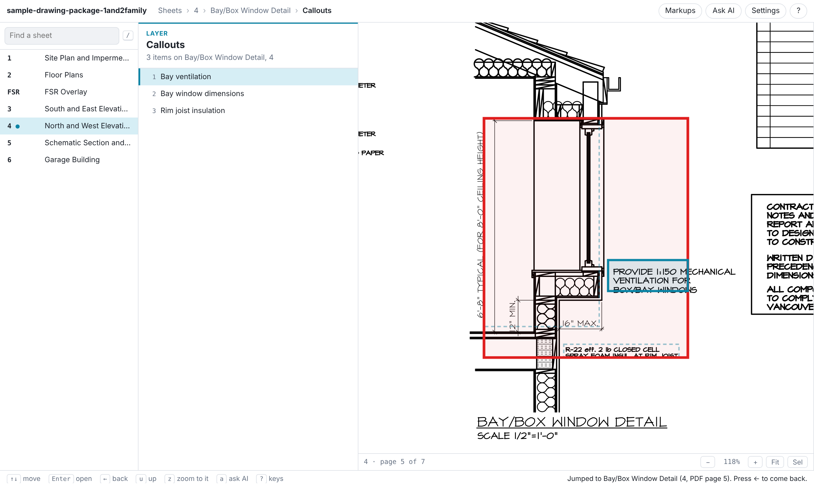

# AECDO — AEC Drawing Ontology

A free, open-source app and open schema for structured data extracted from Architecture, Engineering, and Construction (AEC) drawings.



- **The `aecdo` app** opens any drawing set in the AECDO format (a `.jsonld` file), whichever tool made it. The sheet list, what you've opened, and the PDF page sit side by side, with whatever you pick outlined in red. Ask Claude, ChatGPT, or another model about the drawings in as many chats as you like, and have it take notes, fill in a spreadsheet, or add markups to the PDF.
- **The schema** defines a JSON-LD format for drawing sets: sheets, drawings, layers, items like door tags and walls, schedules, and notes, each with its location on the page.
- **Plain commands** let scripts and AI agents such as Claude Code validate, summarize, and read sets, with a [Claude Code skill](.claude/skills/aecdo/SKILL.md) to go with them.

## 📖 [Read the Getting Started guide](https://jeff-carmichael.github.io/aecdo/)

The guide covers installing, [using the app](https://jeff-carmichael.github.io/aecdo/app.html), the [AI assistant](https://jeff-carmichael.github.io/aecdo/assistant.html), a [walkthrough of the demo set](https://jeff-carmichael.github.io/aecdo/demo.html), the [data model and bbox coordinates](https://jeff-carmichael.github.io/aecdo/data-model.html), and the [commands for scripts and agents](https://jeff-carmichael.github.io/aecdo/agents.html). Its source is in [`docs/`](docs/).

## Install

Windows (PowerShell):

```powershell
irm https://raw.githubusercontent.com/jeff-carmichael/aecdo/main/install.ps1 | iex
```

macOS and Linux:

```bash
curl -sSL https://raw.githubusercontent.com/jeff-carmichael/aecdo/main/install.sh | sh
```

The installer adds **aecdo** to the Start menu, Applications, or your app menu, and offers to download the example drawing set. See [Install and update](https://jeff-carmichael.github.io/aecdo/install.html) for other options, the "Windows protected your PC" warning, and what Linux needs for the app window.

## Open the app

Click **aecdo** in the Start menu (Windows), Applications or Spotlight (macOS), or your app menu (Linux). Choose **Open folder…** to pick the folder with your drawing sets, then pick a set. Or start it from a terminal in that folder:

```bash
cd ~/aecdo-examples
aecdo                                                # pick a set from this folder
aecdo gui sample-drawing-package-1and2family.jsonld # or open one directly
```

The example is the City of Vancouver's sample house permit set, with its PDF (run `aecdo examples` if you skipped it during install). The [demo walkthrough](https://jeff-carmichael.github.io/aecdo/demo.html) gives a first tour, including AI chats and markups. To use the AI assistant, open **Settings** in the app and sign in or add a key; see [AI assistant](https://jeff-carmichael.github.io/aecdo/assistant.html).

## For scripts and agents

The command line is plain and never waits for input:

```bash
aecdo validate plans.jsonld                 # check a file against the schema
aecdo summary plans.jsonld                  # what's in the set
aecdo page plans.jsonld A101 --format json  # one sheet's data
```

See [Command line and agents](https://jeff-carmichael.github.io/aecdo/agents.html) for every command, or run `aecdo --help`. Turning PDFs into AECDO files through the [DrawingBot](https://aecdrawingbot.com) API is [coming soon](https://jeff-carmichael.github.io/aecdo/process.html).

## Schema

Current version: **v0.3.0** — [`ontology/v0.3.0/aecdo.schema.json`](ontology/v0.3.0/aecdo.schema.json). A drawing set is a tree of **DrawingSet → Sheet → Drawing → Layer → Item**, with Tables, Notes, and Images on each sheet. Every `bbox` is `[xmin, ymin, xmax, ymax]` in PDF points from the top-left of the page. See [Data model and bbox](https://jeff-carmichael.github.io/aecdo/data-model.html) for the diagram and details, and [`examples/`](examples/) for a sample file.

## Contributing

See [CONTRIBUTING.md](CONTRIBUTING.md) for development setup, schema change process, and releases.

AECDO is an open standard: any tool can produce or consume conforming files.

## License

Apache License 2.0 — see [LICENSE](LICENSE).
