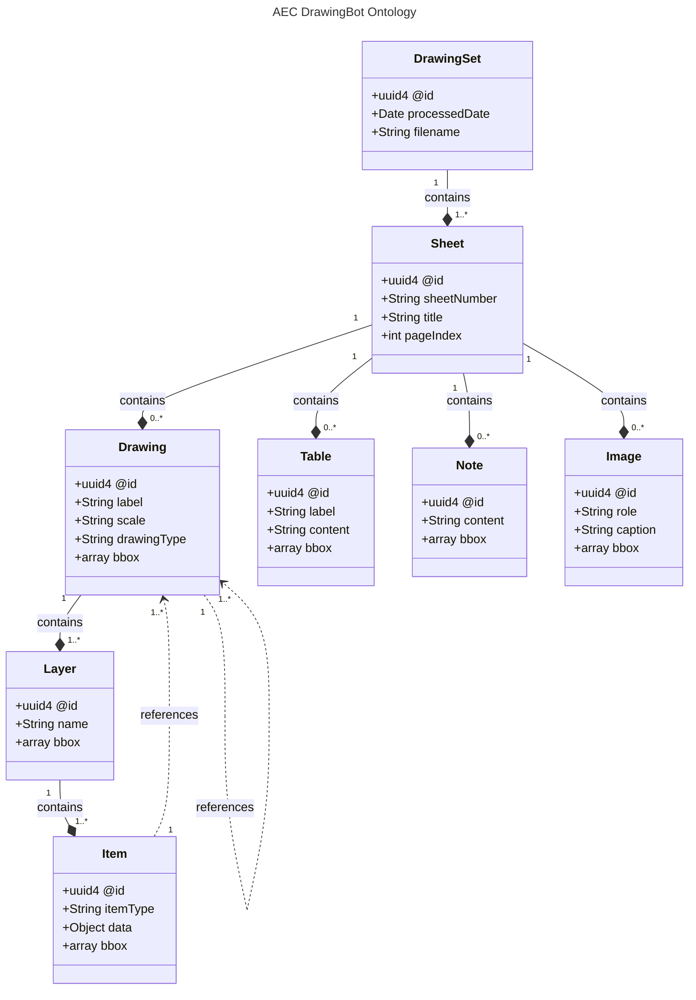

# AECDO — AEC Drawing Ontology

An open schema and CLI for structured data extracted from Architecture, Engineering, and Construction (AEC) drawings.

Tools like [AEC DrawingBot](https://aecdrawingbot.com) use AI to turn drawing sets (floor plans, sections, details, schedules) into JSON-LD files. AECDO defines that format and provides:

- **A schema** for validating extracted drawing data
- **A CLI** to validate, summarize, and explore those files, and to process PDFs through the [DrawingBot API](https://aecdrawingbot.com/api)
- **A [Claude Code skill](.claude/skills/aecdo/SKILL.md)** so AI agents can work with the data

## Install

macOS and Linux:

```bash
curl -sSL https://raw.githubusercontent.com/jeff-carmichael/aecdo/main/install.sh | sh
```

Windows: download `aecdo-windows-x64.zip` from [Releases](https://github.com/jeff-carmichael/aecdo/releases).

## Usage

```bash
aecdo validate drawings.jsonld               # check a file against the schema
aecdo summary drawings.jsonld                # counts of sheets, drawings, items
aecdo sheets drawings.jsonld                 # list sheets
aecdo page drawings.jsonld A101              # print one sheet (by number or page index)
aecdo explore drawings.jsonld                # browse interactively
```

Add `--format json` to any of these for machine-readable output.

### Process a PDF with the DrawingBot API

```bash
aecdo configure                              # one-time: enter API credentials and region
aecdo process plans.pdf -o result.jsonld     # upload, wait, download
aecdo process plans.pdf --then summary       # process and summarize
```

`upload`, `status <jobId> --wait`, and `download <jobId>` run each step separately. Run `aecdo --help` for all options.

## Schema

Current version: **v0.3.0** — [`ontology/v0.3.0/aecdo.schema.json`](ontology/v0.3.0/aecdo.schema.json). See [`examples/sample-drawing-set.jsonld`](examples/sample-drawing-set.jsonld) for a complete file.




| Type | Description |
|------|-------------|
| **DrawingSet** | Root — source filename, processed date, and sheets |
| **Sheet** | A page from the PDF with sheet number, title, and page index |
| **Drawing** | A view on a sheet (plan, section, elevation, detail) with scale and layers |
| **Layer** | Groups related items (e.g. "Walls", "Doors & Windows", "Annotations") |
| **Item** | An extracted entity — `thing` (physical element), `tag` (annotation/symbol), or `area` (region) |
| **Table** | A schedule or table with pipe-delimited content |
| **Note** | A general notes text block |
| **Image** | A raster image on a sheet (`logo`, `photo`, `detail-raster`, `diagram`, `other`); image bytes are not stored |

## Using with Claude Code

Copy the skill into your Claude Code skills folder:

```bash
mkdir -p ~/.claude/skills/aecdo
curl -sSL https://raw.githubusercontent.com/jeff-carmichael/aecdo/main/.claude/skills/aecdo/SKILL.md -o ~/.claude/skills/aecdo/SKILL.md
```

## Contributing

See [CONTRIBUTING.md](CONTRIBUTING.md) for development setup, schema change process, and releases.

AECDO is an open standard: [AEC DrawingBot](https://aecdrawingbot.com) is its main producer, but any tool can produce or consume conforming files.

## License

Apache License 2.0 — see [LICENSE](LICENSE).
