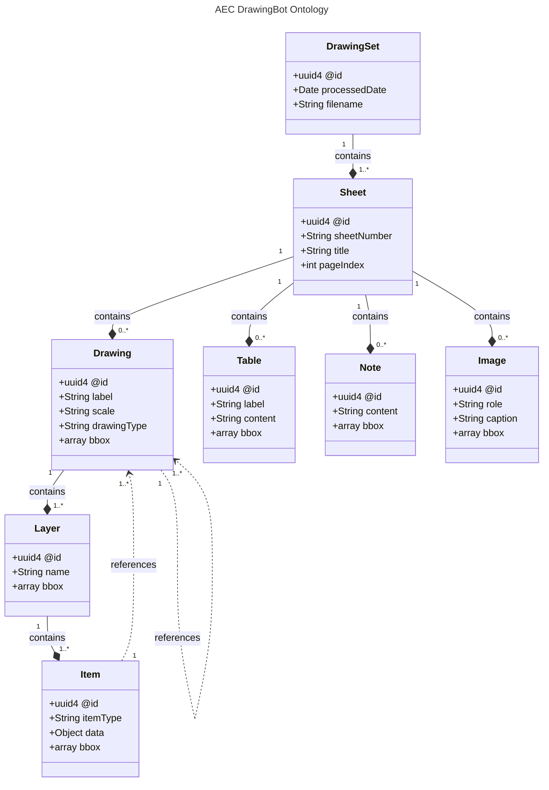

# AECDO — AEC Drawing Ontology

An open schema and CLI for structured data extracted from Architecture, Engineering, and Construction (AEC) drawings.

## What is this?

AEC projects produce hundreds of drawing sheets — floor plans, sections, details, schedules. Tools like [AEC DrawingBot](https://aecdrawingbot.com) use AI to extract structured data from these drawings into machine-readable JSON-LD files.

**AECDO** provides:

1. **An ontology/schema** defining the standard format for extracted drawing data
2. **A CLI tool** for validating, summarizing, exploring, and processing these files — including direct integration with the [DrawingBot API](https://aecdrawingbot.com/api)
3. **A [Claude Code skill](.claude/skills/aecdo/SKILL.md)** for AI agents to work with drawing data programmatically

## Quick Start

### Install

**Standalone binary** (macOS and Linux, no Node.js required):

```bash
curl -sSL https://raw.githubusercontent.com/jeff-carmichael/aecdo/main/install.sh | sh
```

This downloads the right build for your OS and CPU from [GitHub Releases](https://github.com/jeff-carmichael/aecdo/releases), verifies its SHA256 checksum, and installs `aecdo` to `/usr/local/bin` (using `sudo` if needed). Set `AECDO_VERSION=v0.3.0` to pin a release or `AECDO_INSTALL_DIR=~/.local/bin` to install elsewhere. Windows users can download `aecdo-windows-x64.zip` from the releases page.

**From source:**

> **Coming soon:** `npm install -g aecdo` — the package will be published to npm as the primary installation method. For now, install from source:

```bash
git clone https://github.com/jeff-carmichael/aecdo.git
cd aecdo
npm install
```

### Process a PDF via the DrawingBot API

```bash
npx aecdo configure                          # one-time setup: enter API credentials and region
npx aecdo process plans.pdf                  # upload, wait for processing, download result
npx aecdo process plans.pdf --then summary   # process and immediately summarize
npx aecdo process plans.pdf -o result.jsonld # save result to a file
```

Or use the individual commands for scripting:

```bash
npx aecdo upload plans.pdf                   # returns a job ID
npx aecdo status <jobId> --wait              # poll until processing completes
npx aecdo download <jobId> -o result.jsonld  # download the JSON-LD result
```

### Validate a file

```bash
npx aecdo validate examples/sample-drawing-set.jsonld
# ✓ sample-drawing-set.jsonld is valid against AECDO schema.
```

### Summarize

```bash
npx aecdo summary examples/sample-drawing-set.jsonld
```

### List sheets or print one sheet (agent-friendly, non-interactive)

```bash
npx aecdo sheets examples/sample-drawing-set.jsonld --format json
npx aecdo page examples/sample-drawing-set.jsonld A101
npx aecdo page examples/sample-drawing-set.jsonld 0 --format json
```

`sheets` lists every sheet (number, title, page index). `page` prints one sheet selected by sheet number or page index. Both support `--format json` for scripting and LLM agents.

### Explore interactively (humans)

```bash
npx aecdo explore examples/sample-drawing-set.jsonld
```

Loads the file once, validates it, shows the sheet list, then drops into a drill-down prompt. Type a sheet number (e.g. `A101`) or page index (e.g. `0`) to open a sheet: it lists the drawings, tables, notes, and images on that sheet as a numbered menu. Pick a number to dive in — a drawing opens its layers, a layer opens its items, and an item, table, note, or image prints its full details. Type `back` (or `..`) to go up a level, `top` to return to the sheet list, `all` on a sheet to print everything at once, `ls` to reprint the current list, and `quit` to exit.

When stdin is not a TTY or `--format json` is passed, `explore` falls back to listing sheets so pipelines and agents don't hang on the prompt.


```
✓ sample-drawing-set.jsonld is valid against AECDO schema.

  A101 - Ground Floor Plan (page 0)
  A201 - Building Sections (page 1)

  Enter a sheet number or page index to open it.
  "ls" reprints the current list, "quit" exits.

sheet> A101

════════════════════════════════════════════════════════════
  Sheet A101 — Ground Floor Plan (page 0)
════════════════════════════════════════════════════════════

  Drawings (1):
     1. Ground Floor Plan [plan, 1/4" = 1'-0"] — 3 layers, 3 items

  Tables (1):
     2. Door Schedule — 3 rows

  Notes (1):
     3. 1. All dimensions are to face of finish unless noted otherw…

  Images (1):
     4. [logo] Firm logo in title block

A101> 1

  Drawing: Ground Floor Plan [plan, 1/4" = 1'-0"] (sheet A101)
    id:   urn:uuid:22222222-2222-2222-2222-222222222222
    bbox: [72, 108, 720, 540]
    → Building Section A (A201, page 1)

  Layers (3):
     1. Walls — 1 item
     2. Doors & Windows — 1 item
     3. Annotations — 1 item

A101 › Ground Floor Plan> 1

  Layer: Walls
    bbox: [85, 120, 700, 520]

  Items (1):
     1. [THING] Exterior Wall

A101 › Ground Floor Plan › Walls> 1

      [THING] Exterior Wall
        id:   urn:uuid:44444444-4444-4444-4444-444444444444
        bbox: [85, 120, 700, 130]
        data:
          material: CMU 8"
          thickness: 8

A101 › Ground Floor Plan › Walls> q
```

## Schema Overview

The schema is at **v0.3.0** (pre-release). Full definition: [`ontology/v0.3.0/aecdo.schema.json`](ontology/v0.3.0/aecdo.schema.json)

### Hierarchy

> The diagram source is at [`ontology/v0.3.0/diagram.mmd`](ontology/v0.3.0/diagram.mmd)



### Types

| Type | Description |
|------|-------------|
| **DrawingSet** | Root — source filename, processed date, and sheets |
| **Sheet** | A page from the PDF with sheet number, title, and page index |
| **Drawing** | A view on a sheet (plan, section, elevation, detail) with scale and layers |
| **Layer** | Groups related items (e.g. "Walls", "Doors & Windows", "Annotations") |
| **Item** | An extracted entity — `thing` (physical element), `tag` (annotation/symbol), or `area` (region) |
| **Table** | A schedule or table with pipe-delimited content |
| **Note** | A general notes text block |
| **Image** | A raster image embedded on a sheet — records `role` (`logo`, `photo`, `detail-raster`, `diagram`, `other`), optional `caption`, and `bbox`. Image bytes are not stored. |

### Example

```json
{
  "@context": "https://aecdrawingbot.com/ontology/v0.3.0/aecdo#",
  "@id": "urn:uuid:a1b2c3d4-e5f6-7890-abcd-ef1234567890",
  "@type": "DrawingSet",
  "processedDate": "2026-04-10T14:30:00Z",
  "filename": "Example_Building_Plans.pdf",
  "sheets": [
    {
      "@id": "urn:uuid:11111111-1111-1111-1111-111111111111",
      "@type": "Sheet",
      "sheetNumber": "A101",
      "title": "Ground Floor Plan",
      "pageIndex": 0,
      "drawings": [
        {
          "@id": "urn:uuid:22222222-2222-2222-2222-222222222222",
          "@type": "Drawing",
          "label": "Ground Floor Plan",
          "drawingType": "plan",
          "bbox": [72, 108, 720, 540],
          "layers": [
            {
              "@id": "urn:uuid:33333333-3333-3333-3333-333333333333",
              "@type": "Layer",
              "name": "Walls",
              "items": [
                {
                  "@id": "urn:uuid:44444444-4444-4444-4444-444444444444",
                  "@type": "Item",
                  "itemType": "thing",
                  "data": { "label": "Exterior Wall", "material": "CMU 8\"" },
                  "bbox": [85, 120, 700, 130]
                }
              ]
            }
          ]
        }
      ]
    }
  ]
}
```

## Project Structure

```
package.json            npm package root (publishes as "aecdo")
ontology/               Schema definitions (versioned)
  v0.3.0/
    aecdo.schema.json     JSON Schema for validation
    context.jsonld         JSON-LD context for linked data
    diagram.mmd            Mermaid class diagram of the ontology
cli/                    CLI tool (TypeScript, compiled to dist/)
  bin/aecdo.ts            Entry point (npx aecdo)
  bin/standalone.ts       Entry point for Bun standalone binaries (embeds schema + version)
  src/commands/           validate, summary, sheets, page, explore, configure, upload, status, download, process
  src/lib/                Schema loading, output utilities, API client, auth, config
examples/               Sample JSON-LD files
.claude/skills/aecdo/   Claude Code skill (auto-installed by postinstall)
CONTRIBUTING.md         How to contribute (especially schema changes)
CHANGELOG.md            Version history
```

## Building standalone binaries

Requires [Bun](https://bun.sh). Binaries embed the schema, so they run without `node_modules` or the `ontology/` directory.

```bash
npm install
bun run build:bin        # current platform → dist-bin/aecdo
bun run build:bin:all    # darwin-x64, darwin-arm64, linux-x64, linux-arm64, windows-x64 → dist-bin/<target>/
```

Pushing a `v*` tag (matching `package.json`'s version) runs `.github/workflows/release.yml`, which builds all targets, packages them as `.tar.gz` / `.zip`, writes `checksums.txt`, and publishes a GitHub Release.

## For AI Agents

Installing the CLI (`npm install -g aecdo`) automatically copies the Claude Code skill to `~/.claude/skills/aecdo/SKILL.md`. This lets Claude Code use the `aecdo` commands directly when working with drawing data.

## Contributing

See [CONTRIBUTING.md](CONTRIBUTING.md). Schema changes go through an issue-first process to maintain compatibility. The schema uses semantic versioning.

## Relationship to AEC DrawingBot

[AEC DrawingBot](https://aecdrawingbot.com) is the primary producer of AECDO-conformant files. The DrawingBot website will serve the schema directly from this repository. However, AECDO is an open standard — any tool can produce or consume conforming files.

## License

Apache License 2.0 — see [LICENSE](LICENSE).
