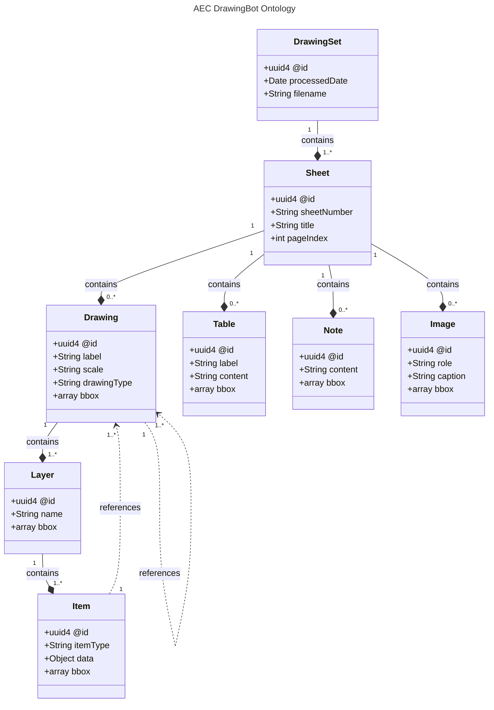

# AECDO — AEC Drawing Ontology

An open schema and CLI for structured data extracted from Architecture, Engineering, and Construction (AEC) drawings.

Tools like [AEC DrawingBot](https://aecdrawingbot.com) use AI to turn drawing sets (floor plans, sections, details, schedules) into JSON-LD files. AECDO defines that format and provides:

- **A schema** for validating extracted drawing data
- **A CLI** to validate, summarize, and explore those files, and to process PDFs through the [DrawingBot API](https://aecdrawingbot.com/api)
- **A [Claude Code skill](.claude/skills/aecdo/SKILL.md)** so AI agents can work with the data

## Install

macOS and Linux:

```bash
curl -sSL https://raw.githubusercontent.com/jeff-carmichael/aecdo/main/install.sh | sh
```

Windows: download `aecdo-windows-x64.zip` from [Releases](https://github.com/jeff-carmichael/aecdo/releases).

## Usage

```bash
aecdo validate drawings.jsonld               # check a file against the schema
aecdo summary drawings.jsonld                # counts of sheets, drawings, items
aecdo sheets drawings.jsonld                 # list sheets
aecdo page drawings.jsonld A101              # print one sheet (by number or page index)
aecdo explore drawings.jsonld                # browse interactively
```

Add `--format json` to any of these for machine-readable output.

### Explore interactively

`explore` opens a sheet list, then lets you drill down: sheet → drawings, tables, notes, and images → layers → items. Type a number to open an entry, `back` (or `..`) to go up, `top` for the sheet list, `all` to print a whole sheet, and `quit` to exit.

```
✓ sample-drawing-set.jsonld is valid against AECDO schema.

  A101 - Ground Floor Plan (page 0)
  A201 - Building Sections (page 1)

  Enter a sheet number or page index to open it.
  "ls" reprints the current list, "quit" exits.

sheet> A101

════════════════════════════════════════════════════════════
  Sheet A101 — Ground Floor Plan (page 0)
════════════════════════════════════════════════════════════

  Drawings (1):
     1. Ground Floor Plan [plan, 1/4" = 1'-0"] — 3 layers, 3 items

  Tables (1):
     2. Door Schedule — 3 rows

  Notes (1):
     3. 1. All dimensions are to face of finish unless noted otherw…

  Images (1):
     4. [logo] Firm logo in title block

A101> 1

  Drawing: Ground Floor Plan [plan, 1/4" = 1'-0"] (sheet A101)
    id:   urn:uuid:22222222-2222-2222-2222-222222222222
    bbox: [72, 108, 720, 540]
    → Building Section A (A201, page 1)

  Layers (3):
     1. Walls — 1 item
     2. Doors & Windows — 1 item
     3. Annotations — 1 item

A101 › Ground Floor Plan> 1

  Layer: Walls
    bbox: [85, 120, 700, 520]

  Items (1):
     1. [THING] Exterior Wall

A101 › Ground Floor Plan › Walls> 1

      [THING] Exterior Wall
        id:   urn:uuid:44444444-4444-4444-4444-444444444444
        bbox: [85, 120, 700, 130]
        data:
          material: CMU 8"
          thickness: 8

A101 › Ground Floor Plan › Walls> q
```

### Process a PDF with the DrawingBot API

```bash
aecdo configure                              # one-time: enter API credentials and region
aecdo process plans.pdf                      # upload, wait, save plans.jsonld next to the PDF
aecdo process plans.pdf -o result.jsonld     # save to a different path
aecdo process plans.pdf --then summary       # save, then summarize
aecdo process plans.pdf --stdout             # print the JSON-LD instead of saving it
```

`process` saves the result by default and overwrites an existing file at that path.

`upload`, `status <jobId> --wait`, and `download <jobId>` run each step separately. Run `aecdo --help` for all options.

### Updating

Run `aecdo update` to replace the installed binary with the latest release. It downloads the build for your platform, checks it against the release's `checksums.txt`, and swaps it in. If the binary is in a folder you can't write to (such as `/usr/local/bin`), run `sudo aecdo update`. npm installs print `npm install -g aecdo@latest` instead.


Once a day, `aecdo` checks [GitHub Releases](https://github.com/jeff-carmichael/aecdo/releases) in the background for a newer version. The check never delays a command: it refreshes a cache at `~/.aecdo/update-check.json`, and the next run prints a notice to stderr suggesting `aecdo update` (so piped stdout stays clean). It is skipped when stderr is not a terminal or `CI` is set. Turn it off with `NO_UPDATE_CHECK=1` or `--no-update-check`.

## Schema

Current version: **v0.3.0** — [`ontology/v0.3.0/aecdo.schema.json`](ontology/v0.3.0/aecdo.schema.json). See [`examples/sample-drawing-set.jsonld`](examples/sample-drawing-set.jsonld) for a complete file.




| Type | Description |
|------|-------------|
| **DrawingSet** | Root — source filename, processed date, and sheets |
| **Sheet** | A page from the PDF with sheet number, title, and page index |
| **Drawing** | A view on a sheet (plan, section, elevation, detail) with scale and layers |
| **Layer** | Groups related items (e.g. "Walls", "Doors & Windows", "Annotations") |
| **Item** | An extracted entity — `thing` (physical element), `tag` (annotation/symbol), or `area` (region) |
| **Table** | A schedule or table with pipe-delimited content |
| **Note** | A general notes text block |
| **Image** | A raster image on a sheet (`logo`, `photo`, `detail-raster`, `diagram`, `other`); image bytes are not stored |

## Using with Claude Code

Copy the skill into your Claude Code skills folder:

```bash
mkdir -p ~/.claude/skills/aecdo
curl -sSL https://raw.githubusercontent.com/jeff-carmichael/aecdo/main/.claude/skills/aecdo/SKILL.md -o ~/.claude/skills/aecdo/SKILL.md
```

## Contributing

See [CONTRIBUTING.md](CONTRIBUTING.md) for development setup, schema change process, and releases.

AECDO is an open standard: [AEC DrawingBot](https://aecdrawingbot.com) is its main producer, but any tool can produce or consume conforming files.

## License

Apache License 2.0 — see [LICENSE](LICENSE).
