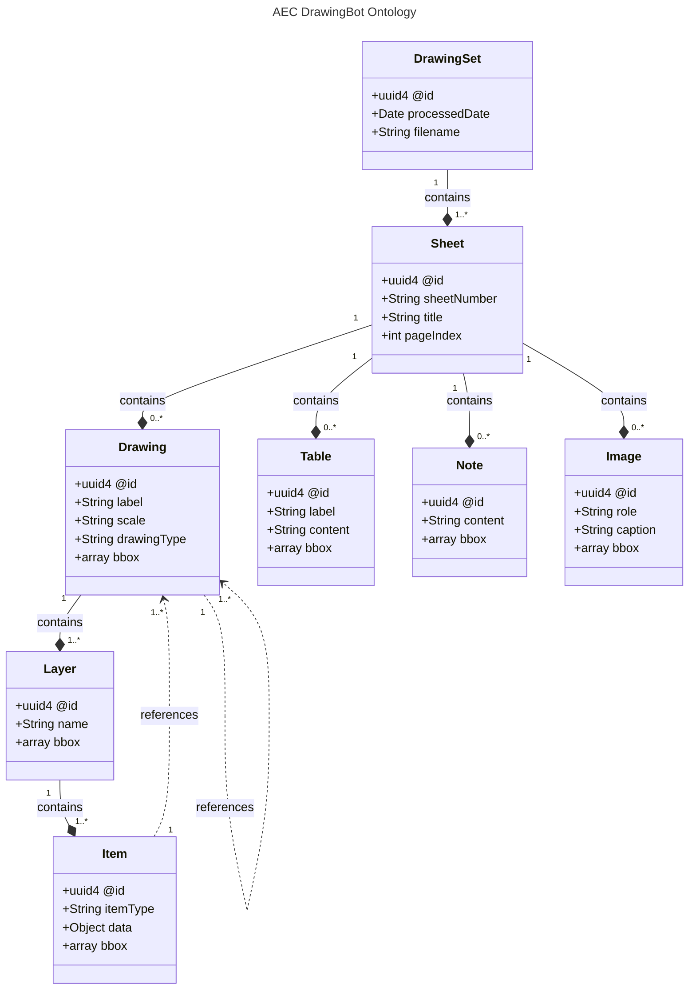

# Data model and bbox coordinates

An AECDO file is a [JSON-LD](https://json-ld.org/) document: ordinary JSON with a few `@`-prefixed fields that make it linked data. You can read it with any JSON tool. This page explains how it's organized, so you can make sense of what `explore` shows you or work with the files in your own code.

The current schema is **v0.3.0**:

- [`aecdo.schema.json`](https://github.com/jeff-carmichael/aecdo/blob/main/ontology/v0.3.0/aecdo.schema.json), the JSON Schema that `aecdo validate` checks against
- [`context.jsonld`](https://github.com/jeff-carmichael/aecdo/blob/main/ontology/v0.3.0/context.jsonld), the JSON-LD context
- [`sample-drawing-set.jsonld`](https://github.com/jeff-carmichael/aecdo/blob/main/examples/sample-drawing-set.jsonld), a minimal complete example

## How it's organized

A **DrawingSet** (one PDF) contains **Sheets** (pages). Each sheet contains **Drawings**, plus **Tables**, **Notes**, and **Images**. Each drawing contains **Layers**, and each layer contains **Items**. Drawings and items can point to other drawings, like a section cut on a plan pointing to the section.



| Type | Description |
|------|-------------|
| **DrawingSet** | Root — source filename, processed date, and sheets |
| **Sheet** | A page from the PDF with sheet number, title, and page index |
| **Drawing** | A view on a sheet (plan, section, elevation, detail) with scale and layers |
| **Layer** | Groups related items (e.g. "Walls", "Doors & Windows", "Annotations") |
| **Item** | An extracted entity — `thing` (physical element), `tag` (annotation/symbol), or `area` (region) |
| **Table** | A schedule or table with pipe-delimited content |
| **Note** | A general notes text block |
| **Image** | A raster image on a sheet (`logo`, `photo`, `detail-raster`, `diagram`, `other`); image bytes are not stored |

Every object has an `@id`, a UUID written as `urn:uuid:…`, and an `@type`. References between objects (`references`) are lists of these ids.

## A small example

```json
{
  "@context": "https://aecdrawingbot.com/ontology/v0.3.0/aecdo#",
  "@id": "urn:uuid:a1b2c3d4-e5f6-7890-abcd-ef1234567890",
  "@type": "DrawingSet",
  "processedDate": "2026-04-10T14:30:00Z",
  "filename": "Example_Building_Plans.pdf",
  "sheets": [
    {
      "@id": "urn:uuid:11111111-1111-1111-1111-111111111111",
      "@type": "Sheet",
      "sheetNumber": "A101",
      "title": "Ground Floor Plan",
      "pageIndex": 0,
      "drawings": [
        {
          "@id": "urn:uuid:22222222-2222-2222-2222-222222222222",
          "@type": "Drawing",
          "label": "Ground Floor Plan",
          "scale": "1/4\" = 1'-0\"",
          "drawingType": "plan",
          "bbox": [72, 108, 720, 540],
          "layers": [
            {
              "@id": "urn:uuid:33333333-3333-3333-3333-333333333333",
              "@type": "Layer",
              "name": "Walls",
              "items": [
                {
                  "@id": "urn:uuid:44444444-4444-4444-4444-444444444444",
                  "@type": "Item",
                  "itemType": "thing",
                  "data": { "label": "Exterior Wall", "material": "CMU 8\"", "thickness": 8 },
                  "bbox": [85, 120, 700, 130]
                }
              ]
            }
          ]
        }
      ]
    }
  ]
}
```

A few things to know:

- **`pageIndex`** counts from 0, so the first page of the PDF is page 0.
- **`drawingType`** is one of `plan`, `section`, `elevation`, or `detail`.
- **`itemType`** is `thing` (a physical element), `tag` (an annotation or symbol), or `area` (a region).
- **`data`** on an item is free-form. What's in it depends on what was extracted: a wall may have `material` and `thickness`, a door `mark`, `width`, and `doorType`.
- **Table `content`** is plain text: one row per line, with cells separated by `|`. The first line is the header.

## bbox coordinates

Drawings, layers, items, tables, notes, and images can have a `bbox` that says where they are on the page. It's always four numbers:

```
[xmin, ymin, xmax, ymax]
```

- **Units are PDF points**: 1/72 of an inch. A box 72 points wide is 1 inch wide on the printed sheet.
- **The origin is the top-left corner** of the page as you see it (after any page rotation in the PDF).
- **y increases downward**, as on a screen, not upward as in PDF's internal coordinates.
- **Values aren't normalized**, so the range depends on the page size. A 36 × 24 in ARCH D sheet runs from 0 to 2592 across and 0 to 1728 down.

For example, the door tag `[408.5, 747.5, 428.5, 767.5]` is a 20 × 20 point box (about 0.28 in square) whose top-left corner is 5.7 in from the left edge and 10.4 in from the top.

To draw a bbox on an image of the page rendered at a given DPI, multiply each value by `DPI / 72`. At 72 DPI, one pixel is one point.

This is exactly how [`view`](explore.md#see-it-on-the-page-view) draws its red box. If the box lands in the wrong place, or `view` warns that it "runs past the page", the file was probably made with different units.

## Validating your own files

Any tool can produce AECDO files. To check one:

```bash
aecdo validate my-file.jsonld
aecdo validate my-file.jsonld --format json     # {"valid": true, "file": "…", "errors": []}
aecdo validate my-file.jsonld --schema path/to/custom.schema.json
```

`validate` exits with status 1 when the file doesn't match, so it works in CI.

To propose a change to the schema, see [CONTRIBUTING.md](https://github.com/jeff-carmichael/aecdo/blob/main/CONTRIBUTING.md#contributing-to-the-ontologyschema).
