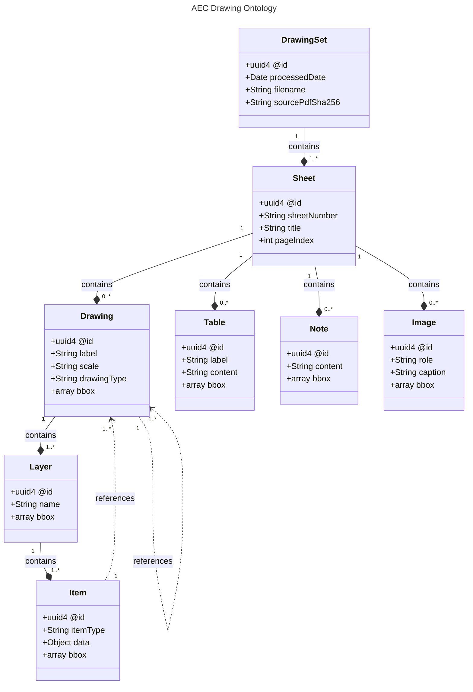

# Data model and bbox coordinates

For developers. An AECDO file is [JSON-LD](https://json-ld.org/): plain JSON with a few `@` fields. Schema **v0.3.0**: [JSON Schema](https://github.com/jeff-carmichael/aecdo/blob/main/ontology/v0.3.0/aecdo.schema.json), [context](https://github.com/jeff-carmichael/aecdo/blob/main/ontology/v0.3.0/context.jsonld), [full example](https://github.com/jeff-carmichael/aecdo/blob/main/examples/sample-drawing-package-1and2family.jsonld).

## How it's organized

DrawingSet → Sheet → Drawing → Layer → Item, plus Tables, Notes, and Images on each sheet. Drawings and items can reference other drawings.



| Type | Description |
|------|-------------|
| **DrawingSet** | Root — source filename, the PDF's SHA-256 (optional), processed date, and sheets |
| **Sheet** | A page from the PDF with sheet number, title, and page index |
| **Drawing** | A view on a sheet (plan, section, elevation, detail) with scale and layers |
| **Layer** | Groups related items (e.g. "Walls", "Doors & Windows", "Annotations") |
| **Item** | An extracted entity — `thing` (physical element), `tag` (annotation/symbol), or `area` (region) |
| **Table** | A schedule or table with pipe-delimited content |
| **Note** | A general notes text block |
| **Image** | A raster image on a sheet (`logo`, `photo`, `detail-raster`, `diagram`, `other`); image bytes are not stored |

Every object has an `@id` (`urn:uuid:…`) and an `@type`. `references` lists other objects' ids.

## A small example

```json
{
  "@context": "https://aecdrawingbot.com/ontology/v0.3.0/aecdo#",
  "@id": "urn:uuid:a1b2c3d4-e5f6-7890-abcd-ef1234567890",
  "@type": "DrawingSet",
  "processedDate": "2026-04-10T14:30:00Z",
  "filename": "Example_Building_Plans.pdf",
  "sourcePdfSha256": "33777aa3b672010af2f61033d0b788ccc735ebc08919b169f25fc2074b8e61fc",
  "sheets": [
    {
      "@id": "urn:uuid:11111111-1111-1111-1111-111111111111",
      "@type": "Sheet",
      "sheetNumber": "A101",
      "title": "Ground Floor Plan",
      "pageIndex": 0,
      "drawings": [
        {
          "@id": "urn:uuid:22222222-2222-2222-2222-222222222222",
          "@type": "Drawing",
          "label": "Ground Floor Plan",
          "scale": "1/4\" = 1'-0\"",
          "drawingType": "plan",
          "bbox": [72, 108, 720, 540],
          "layers": [
            {
              "@id": "urn:uuid:33333333-3333-3333-3333-333333333333",
              "@type": "Layer",
              "name": "Walls",
              "items": [
                {
                  "@id": "urn:uuid:44444444-4444-4444-4444-444444444444",
                  "@type": "Item",
                  "itemType": "thing",
                  "data": { "label": "Exterior Wall", "material": "CMU 8\"", "thickness": 8 },
                  "bbox": [85, 120, 700, 130]
                }
              ]
            }
          ]
        }
      ]
    }
  ]
}
```

- `pageIndex` starts at 0.
- `drawingType`: `plan`, `section`, `elevation`, or `detail`.
- `itemType`: `thing`, `tag`, or `area`.
- Item `data` is free-form.
- Table `content` is one row per line, cells split by `|`, header first.

## bbox coordinates

A `bbox` is `[xmin, ymin, xmax, ymax]`:

- in PDF points (1/72 in), not normalized;
- from the top-left of the page as displayed (after rotation);
- with y going down.

To draw one on a page image rendered at a given DPI, multiply by `DPI / 72`. If the app's boxes land in the wrong place, the file likely uses other units.

## Making your own files

Any tool can write AECDO files. Give every object a unique `@id`, write bboxes as above, set `filename` to the PDF's name, and save the `.jsonld` beside that PDF. Add `sourcePdfSha256`, the PDF's SHA-256 (`shasum -a 256 plans.pdf`), so the app can warn when someone opens the set with a different PDF. Then check it:

```bash
aecdo validate my-file.jsonld --pdf my-file.pdf
```

It exits with 1 if the file doesn't match the schema, or the PDF isn't the one in `sourcePdfSha256`. Schema changes: see [CONTRIBUTING.md](https://github.com/jeff-carmichael/aecdo/blob/main/CONTRIBUTING.md#contributing-to-the-ontologyschema).
