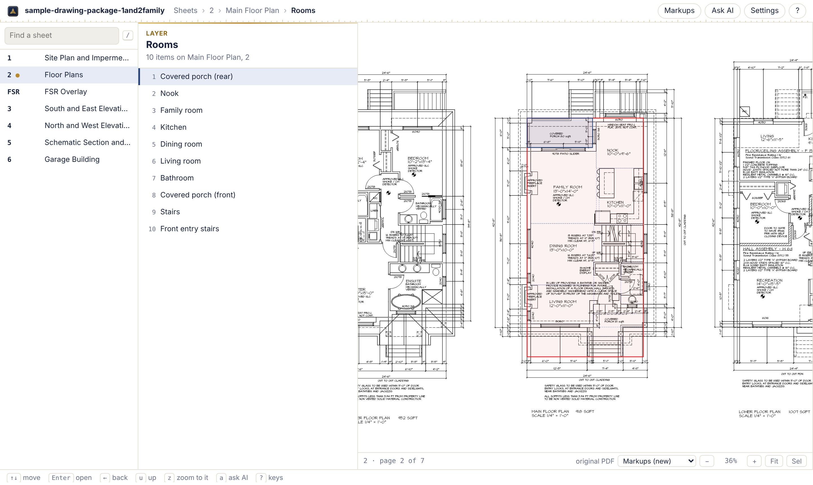

# Getting started

A free app for reading, checking, and marking up construction drawing data.

{: .shot}

aecdo opens drawing sets in the open AECDO format (`.jsonld` files): sheets, drawings, rooms, doors, schedules, and notes, each tied to its spot on the PDF.

<ol class="steps">
<li markdown="1">
**Install.** Open PowerShell (Windows) or Terminal (Mac, Linux), paste the line, and press <kbd>Enter</kbd>.

Windows:

```powershell
irm https://raw.githubusercontent.com/jeff-carmichael/aecdo/main/install.ps1 | iex
```

Mac or Linux:

```bash
curl -sSL https://raw.githubusercontent.com/jeff-carmichael/aecdo/main/install.sh | sh
```

Say yes to the example set.
</li>
<li markdown="1">
**Open aecdo** from the Start menu, Applications, or your app menu.
</li>
<li markdown="1">
**Open the example.** Choose **Open another folder…**, pick `aecdo-examples`, then the sample set.
</li>
<li markdown="1">
**Look around.** Arrow keys and <kbd>Enter</kbd> open sheets, drawings, and items. <kbd>←</kbd> goes back. <kbd>?</kbd> lists every key.
</li>
<li markdown="1">
**Ask the AI** (optional). Press <kbd>,</kbd> to sign in, then <kbd>a</kbd> to ask.
</li>
</ol>

For your own drawings, keep the PDF beside the set with the same name: `plans.pdf` next to `plans.jsonld`.

Problems? See [Troubleshooting](troubleshooting.md) or [open an issue](https://github.com/jeff-carmichael/aecdo/issues).
